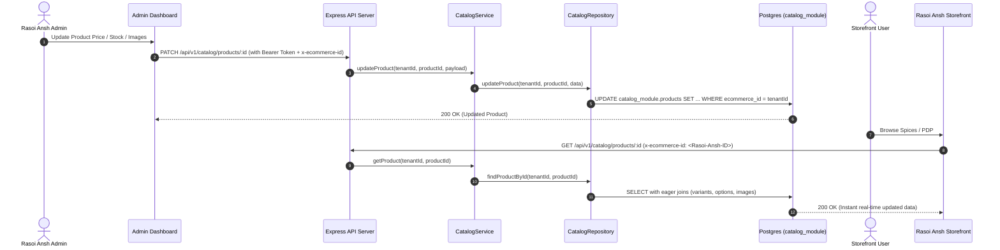

# Rasoi Ansh Storefront & Admin API Integration Guide

This guide provides end-to-end endpoint specifications, request/response structures, backend architectural file breakdowns (including `catalog.repository.ts`, `catalog.service.ts`, `catalog.routes.ts`), and frontend integration blueprints for connecting both the **Rasoi Ansh Customer Storefront** and the **Rasoi Ansh Admin Panel** with the multi-tenant backend platform.

---

## 1. Tenant & Environment Configuration

| Property | Value | Notes |
| :--- | :--- | :--- |
| **Store Name** | `Rasoi Ansh` | Fourth tenant in the multi-tenant platform |
| **Tenant Slug** | `rasoi-ansh` | Unique store routing identifier |
| **Backend Base URL (Local)** | `http://localhost:3000/api/v1` | Express API Server |
| **Admin Login Email** | `freshharvest_admin@bazar.com` | Store Admin credentials |
| **Admin Login Password** | `Password123!` | Store Admin password |
| **Role Assigned** | `ecommerce_admin` | Scoped strictly to the Rasoi Ansh Store ID |
| **Database Schema** | `catalog_module` | Dedicated PostgreSQL schema for catalog data |

---

## 2. Backend Architecture & Catalog Files Breakdown

The backend follows a strict **Node.js Modular Monolith** architecture. All catalog management and storefront querying logic is housed within `src/modules/catalog/`.

```
src/modules/catalog/
├── index.ts              # Public API barrel export (Exports CatalogService and catalogRoutes)
├── catalog.routes.ts     # Express router registering all /catalog endpoints
├── catalog.controller.ts # Request handlers parsing params/body and invoking service
├── catalog.service.ts    # Core business logic, validation, stock checks, pricing rules
├── catalog.repository.ts # Data access layer (Sequelize queries, relations, schema isolation)
├── catalog.validator.ts  # Zod schemas for all payload validations
├── catalog.models.ts     # Sequelize model definitions in schema 'catalog_module'
└── catalog.tenant-guard.ts # Resolves tenant ID from header/user and enforces tenant scoping
```

### 2.1 `catalog.repository.ts` (Data Access Layer)

The repository encapsulates all direct Sequelize queries and raw SQL operations. Per architectural guardrails, it is **never exported** outside the catalog module.

#### Key Functions and Responsibilities in `catalog.repository.ts`:
- **Tenant Scoping**: All queries filter by `ecommerce_id` ensuring Rasoi Ansh data is strictly isolated from other tenants.
- **Product Hierarchy Queries (`findProductById`, `findAllProducts`)**: Joins `CategoryModel`, `ProductOptionModel`, `ProductOptionValueModel`, `ProductVariantModel`, `ProductImageModel`, and `ProductVariantImageModel`. Computes live aggregate inventory (`computedQuantity`).
- **Variants & Cartesian Options**: Manages `ProductVariantModel` linked to multiple `ProductOptionValueModel` entries via the join table `catalog_module.product_variant_option_values`.
- **Image Management**: Handles primary and secondary gallery images with auto-sequenced `display_order`.
- **Order Persistence & Customer Aggregation**: Records checkout orders and dynamically aggregates customer metrics (total spent, order count, VIP/ACTIVE status) using optimized SQL grouping.
- **Promotional Coupons & Rules Engine**: Queries active coupons, usage limits, minimum order values, and category restrictions.
- **Banners & Sliders**: Queries active marketing carousels ordered by `display_order`.

### 2.2 Data Synchronization Flow (Admin Panel ➔ Backend DB ➔ Customer Storefront)



---

## 3. Authentication & Common Headers

All catalog endpoints are secured by authentication and tenant validation.

### Required Request Headers
```http
Authorization: Bearer <accessToken>
x-ecommerce-id: <rasoi_ansh_tenant_id>
Content-Type: application/json
```

> **Storefront Public Requests:** On public customer endpoints (browsing categories, products, active banners, validating coupons), pass the store's tenant ID in the `x-ecommerce-id` header or `?storeId=<id>`. When authenticated as the store admin, send the JWT `Bearer` token.

---

## 4. Authentication Endpoints

### 4.1 Admin Login
`POST /api/v1/auth/login`

#### Request Body
```json
{
  "email": "freshharvest_admin@bazar.com",
  "password": "Password123!"
}
```

#### Response (`200 OK`)
```json
{
  "success": true,
  "data": {
    "accessToken": "eyJhbGciOiJIUzI1NiIsInR5cCI6IkpXVCJ9...",
    "refreshToken": "eyJhbGciOiJIUzI1NiIsInR5cCI6IkpXVCJ9...",
    "user": {
      "id": "user-uuid-rasoi-admin",
      "email": "freshharvest_admin@bazar.com",
      "name": "David Chen (Rasoi Ansh)"
    },
    "organisation": {
      "id": "tenant-uuid-rasoi-ansh",
      "name": "Rasoi Ansh",
      "slug": "rasoi-ansh"
    }
  }
}
```

### 4.2 Get Current Profile (`Me`)
`GET /api/v1/auth/me`

#### Response (`200 OK`)
```json
{
  "success": true,
  "data": {
    "user": {
      "id": "user-uuid-rasoi-admin",
      "email": "freshharvest_admin@bazar.com",
      "name": "David Chen (Rasoi Ansh)"
    },
    "organisation": {
      "id": "tenant-uuid-rasoi-ansh",
      "name": "Rasoi Ansh",
      "slug": "rasoi-ansh"
    },
    "isSuperAdmin": false,
    "roles": ["ecommerce_admin"],
    "permissions": ["manage:all"]
  }
}
```

---

## 5. Categories API (Taxonomy & Navigation)

### 5.1 List Categories (Storefront Navbar & Admin Table)
`GET /api/v1/catalog/categories`

#### Response (`200 OK`)
```json
{
  "success": true,
  "data": [
    {
      "id": "cat-uuid-1",
      "ecommerceId": "tenant-uuid-rasoi-ansh",
      "name": "Spices & Masalas",
      "slug": "spices-masalas",
      "description": "Authentic Indian blended spices and curry powders",
      "parentId": null,
      "displayOrder": 0
    },
    {
      "id": "cat-uuid-2",
      "ecommerceId": "tenant-uuid-rasoi-ansh",
      "name": "Whole Spices",
      "slug": "whole-spices",
      "description": "Single-origin farm fresh whole spices",
      "parentId": null,
      "displayOrder": 1
    }
  ]
}
```

### 5.2 Create Category (Admin Panel)
`POST /api/v1/catalog/categories`

#### Request Body
```json
{
  "name": "Organic Herbs & Seasonings",
  "slug": "organic-herbs-seasonings",
  "description": "Sun-dried culinary herbs and seasonings",
  "parentId": null,
  "displayOrder": 2
}
```

### 5.3 Update & Delete Category
- `PATCH /api/v1/catalog/categories/:id`
- `DELETE /api/v1/catalog/categories/:id`

---

## 6. Products, Variants, Options & Image Management

### 6.1 List Products (Catalog / Listing Page)
`GET /api/v1/catalog/products`

#### Query Parameters:
- `categoryId` *(optional)*: Filter by category UUID
- `status` *(optional)*: `ACTIVE` | `DRAFT` | `ARCHIVED`

#### Response (`200 OK`)
```json
{
  "success": true,
  "data": [
    {
      "id": "prod-uuid-101",
      "ecommerceId": "tenant-uuid-rasoi-ansh",
      "categoryId": "cat-uuid-1",
      "name": "Royal Garam Masala Blend",
      "slug": "royal-garam-masala-blend",
      "description": "Signature artisanal blend of 16 roasted whole spices",
      "details": ["100% Natural", "No Preservatives", "Stone Ground"],
      "price": 14.99,
      "offerPrice": 12.99,
      "taxRate": 5,
      "taxClass": "GST 5%",
      "quantity": 0,
      "computedQuantity": 200,
      "status": "ACTIVE",
      "hasVariants": true,
      "category": {
        "id": "cat-uuid-1",
        "name": "Spices & Masalas",
        "slug": "spices-masalas"
      },
      "images": [
        {
          "id": "img-uuid-1",
          "imageUrl": "https://images.unsplash.com/photo-1596040033229-a9821ebd058d",
          "displayOrder": 0,
          "isPrimary": true
        }
      ]
    }
  ]
}
```

### 6.2 Get Full Product Details (PDP Page)
`GET /api/v1/catalog/products/:id`

Returns complete hierarchical data: base product attributes, category, options (e.g. Weight), units (`gram`, `kg`), all variants with SKU and variant prices, and gallery images.

#### Response (`200 OK`)
```json
{
  "success": true,
  "data": {
    "id": "prod-uuid-101",
    "ecommerceId": "tenant-uuid-rasoi-ansh",
    "name": "Royal Garam Masala Blend",
    "slug": "royal-garam-masala-blend",
    "description": "Signature artisanal blend of 16 roasted whole spices",
    "price": 14.99,
    "offerPrice": 12.99,
    "hasVariants": true,
    "computedQuantity": 200,
    "category": {
      "id": "cat-uuid-1",
      "name": "Spices & Masalas",
      "slug": "spices-masalas"
    },
    "options": [
      {
        "id": "opt-uuid-weight",
        "name": "Weight",
        "displayOrder": 0,
        "values": [
          {
            "id": "val-uuid-100g",
            "value": "100",
            "unit": {
              "id": "unit-gram",
              "name": "Gram",
              "symbol": "g",
              "category": "Weight"
            }
          },
          {
            "id": "val-uuid-250g",
            "value": "250",
            "unit": {
              "id": "unit-gram",
              "name": "Gram",
              "symbol": "g",
              "category": "Weight"
            }
          },
          {
            "id": "val-uuid-500g",
            "value": "500",
            "unit": {
              "id": "unit-gram",
              "name": "Gram",
              "symbol": "g",
              "category": "Weight"
            }
          }
        ]
      }
    ],
    "variants": [
      {
        "id": "var-uuid-100g",
        "sku": "ROYALGAR-100G",
        "price": 4.99,
        "offerPrice": null,
        "quantity": 80,
        "status": "ACTIVE",
        "optionValues": [
          { "id": "val-uuid-100g", "value": "100" }
        ],
        "images": []
      },
      {
        "id": "var-uuid-250g",
        "sku": "ROYALGAR-250G",
        "price": 9.99,
        "offerPrice": 8.99,
        "quantity": 70,
        "status": "ACTIVE",
        "optionValues": [
          { "id": "val-uuid-250g", "value": "250" }
        ],
        "images": []
      },
      {
        "id": "var-uuid-500g",
        "sku": "ROYALGAR-500G",
        "price": 14.99,
        "offerPrice": 12.99,
        "quantity": 50,
        "status": "ACTIVE",
        "optionValues": [
          { "id": "val-uuid-500g", "value": "500" }
        ],
        "images": []
      }
    ],
    "images": [
      {
        "id": "img-uuid-1",
        "imageUrl": "https://images.unsplash.com/photo-1596040033229-a9821ebd058d",
        "displayOrder": 0,
        "isPrimary": true
      }
    ]
  }
}
```

### 6.3 Create Product (Admin Panel)
`POST /api/v1/catalog/products`

#### Request Body
```json
{
  "name": "Turmeric Root Powder (High Curcumin)",
  "slug": "turmeric-root-powder-high-curcumin",
  "categoryId": "cat-uuid-1",
  "price": 8.50,
  "offerPrice": 7.50,
  "quantity": 100,
  "description": "Pure organic Lakadong turmeric powder with 7%+ curcumin content.",
  "status": "ACTIVE",
  "hasVariants": true,
  "details": ["7%+ Curcumin", "Non-irradiated", "Organic Certified"]
}
```

### 6.4 Product Image Uploads (Admin Panel)
`POST /api/v1/catalog/products/:productId/images`
- `Content-Type`: `multipart/form-data`
- Body Field: `images` (up to 10 files)

---

## 7. Promotional Banners API (Hero Slider & Specials)

### 7.1 List Active Banners (Storefront Homepage)
`GET /api/v1/catalog/banners`

#### Response (`200 OK`)
```json
{
  "success": true,
  "data": [
    {
      "id": "banner-uuid-1",
      "ecommerceId": "tenant-uuid-rasoi-ansh",
      "title": "Fresh Farm Harvest",
      "subtitle": "Get up to 25% off on whole artisanal spices",
      "imageUrl": "https://images.unsplash.com/photo-1509358271058-acd22cc93898",
      "redirectUrl": "/category/whole-spices",
      "displayOrder": 0,
      "isActive": true
    }
  ]
}
```

### 7.2 Create Banner (Admin Panel)
`POST /api/v1/catalog/banners`

#### Request Body
```json
{
  "title": "Festive Spice Combos",
  "subtitle": "Curated masala boxes for celebration feasts",
  "imageUrl": "https://images.unsplash.com/photo-1596040033229-a9821ebd058d",
  "redirectUrl": "/category/spices-masalas",
  "displayOrder": 1,
  "isActive": true
}
```

---

## 8. Coupons & Real-Time Cart Validation API

### 8.1 Validate Coupon in Cart (Storefront Checkout)
`POST /api/v1/catalog/coupons/validate`

#### Request Body
```json
{
  "code": "RASOI20",
  "customerEmail": "customer@example.com",
  "subtotal": 50.00,
  "cartItems": [
    {
      "productId": "prod-uuid-101",
      "quantity": 2,
      "pricing": {
        "effectivePrice": 12.99
      },
      "product": {
        "id": "prod-uuid-101",
        "categoryId": "cat-uuid-1",
        "price": 14.99
      }
    }
  ]
}
```

#### Response (`200 OK` - Valid)
```json
{
  "success": true,
  "data": {
    "valid": true,
    "couponId": "coupon-uuid-rasoi20",
    "code": "RASOI20",
    "discountType": "PERCENTAGE",
    "discountValue": 20,
    "discountAmount": 10.00,
    "eligibleSubtotal": 50.00,
    "message": "Coupon applied successfully"
  }
}
```

---

## 9. Orders & Checkout API

### 9.1 Place an Order (Customer Storefront)
`POST /api/v1/catalog/orders`

#### Request Body
```json
{
  "customerName": "Aarav Sharma",
  "customerEmail": "aarav.sharma@example.com",
  "customerPhone": "+919876543210",
  "itemsCount": 2,
  "total": 40.00,
  "status": "PROCESSING",
  "couponId": "coupon-uuid-rasoi20",
  "couponCode": "RASOI20",
  "couponDiscount": 10.00,
  "shippingAddress": {
    "street": "42 Heritage Spice Street",
    "city": "Jaipur",
    "state": "Rajasthan",
    "postalCode": "302001",
    "country": "India"
  },
  "items": [
    {
      "productId": "prod-uuid-101",
      "productName": "Royal Garam Masala Blend",
      "sku": "ROYALGAR-250G",
      "variantId": "var-uuid-250g",
      "quantity": 2,
      "price": 8.99,
      "total": 17.98,
      "options": {
        "Weight": "250 g"
      }
    }
  ]
}
```

#### Response (`201 Created`)
```json
{
  "success": true,
  "data": {
    "id": "order-uuid-501",
    "ecommerceId": "tenant-uuid-rasoi-ansh",
    "customerName": "Aarav Sharma",
    "customerEmail": "aarav.sharma@example.com",
    "customerPhone": "+919876543210",
    "itemsCount": 2,
    "total": 40.00,
    "status": "PROCESSING",
    "couponCode": "RASOI20",
    "couponDiscount": 10.00,
    "createdAt": "2026-09-04T10:00:00.000Z"
  }
}
```

### 9.2 List Orders (Admin Panel)
`GET /api/v1/catalog/orders`

### 9.3 Update Order Status (Admin Panel)
`PATCH /api/v1/catalog/orders/:id`
```json
{
  "status": "SHIPPED"
}
```

---

## 10. Customer Analytics API (Admin Panel)

`GET /api/v1/catalog/customers`

#### Response (`200 OK`)
Aggregates customer spend and order volume:
```json
{
  "success": true,
  "data": [
    {
      "id": "cust-aarav-sharma@example.com",
      "name": "Aarav Sharma",
      "email": "aarav.sharma@example.com",
      "phone": "+919876543210",
      "totalOrders": 4,
      "totalSpent": 185.50,
      "joinedDate": "2026-08-15T09:30:00.000Z",
      "lastOrderDate": "2026-09-04T10:00:00.000Z",
      "status": "VIP"
    }
  ]
}
```

---

## 11. Frontend Integration Blueprint (`src/lib/api.ts`)

Use this production-ready API client in the **Rasoi Ansh Storefront** application to communicate with the backend.

```typescript
// src/lib/api.ts

const BACKEND_URL = process.env.NEXT_PUBLIC_BACKEND_URL || 'http://localhost:3000/api/v1';
const ECOMMERCE_ID = process.env.NEXT_PUBLIC_ECOMMERCE_ID || 'tenant-uuid-rasoi-ansh';

export interface ApiResponse<T> {
  success: boolean;
  data: T;
  message?: string;
}

export async function fetchStorefront<T>(endpoint: string, options: RequestInit = {}): Promise<T> {
  const token = typeof window !== 'undefined' ? localStorage.getItem('rasoi_ansh_token') : null;

  const headers: HeadersInit = {
    'Content-Type': 'application/json',
    'x-ecommerce-id': ECOMMERCE_ID,
    ...(token ? { Authorization: `Bearer ${token}` } : {}),
    ...(options.headers || {}),
  };

  const response = await fetch(`${BACKEND_URL}${endpoint}`, {
    ...options,
    headers,
    cache: 'no-store', // Ensures fresh data sync on every navigation
  });

  const json: ApiResponse<T> = await response.json();
  if (!response.ok || !json.success) {
    throw new Error(json.message || `API request failed with status ${response.status}`);
  }
  return json.data;
}

// ==================== Rasoi Ansh Storefront Methods ====================
export const getCategories = () => fetchStorefront<any[]>('/catalog/categories');
export const getProducts = (categoryId?: string) =>
  fetchStorefront<any[]>(`/catalog/products${categoryId ? `?categoryId=${categoryId}` : ''}`);
export const getProductDetails = (id: string) => fetchStorefront<any>(`/catalog/products/${id}`);
export const getBanners = () => fetchStorefront<any[]>('/catalog/banners');
export const validateCoupon = (payload: any) =>
  fetchStorefront<any>('/catalog/coupons/validate', { method: 'POST', body: JSON.stringify(payload) });
export const placeOrder = (orderData: any) =>
  fetchStorefront<any>('/catalog/orders', { method: 'POST', body: JSON.stringify(orderData) });
```
