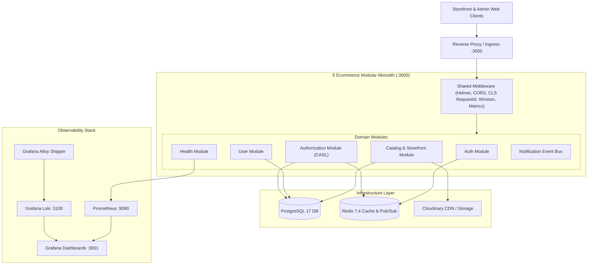
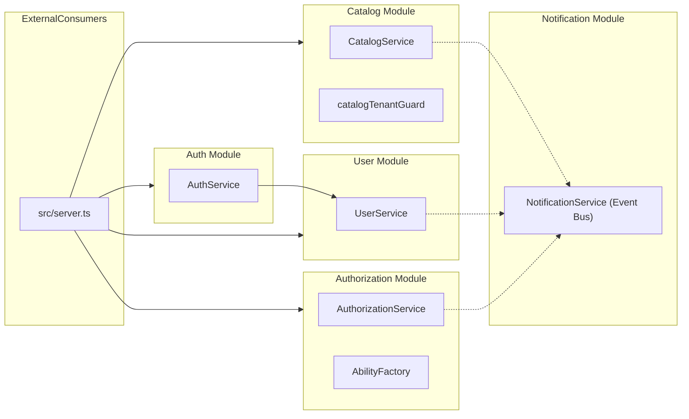
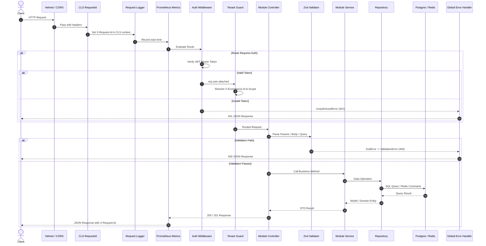
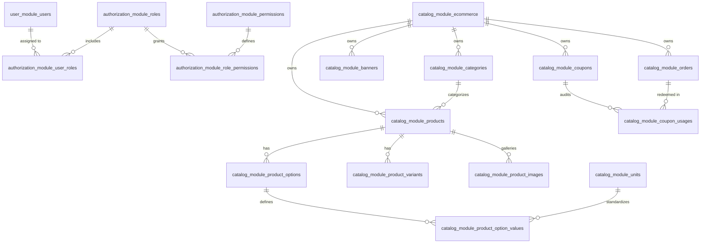

# 5 Ecommerce — Modular Monolith Architecture

## 1. System Context & Overview
**5 Ecommerce** is an enterprise-grade multi-tenant ecommerce platform built as a **Modular Monolith** in Node.js and TypeScript. It combines the deployment simplicity of a monolithic service with the domain isolation, clear boundaries, and clean maintenance characteristics of microservices.



---

## 2. Technology Stack

| Layer | Technology | Version | Purpose |
|---|---|---|---|
| **Runtime** | Node.js | `>=20.0.0` (Container uses 24-slim) | High-performance asynchronous execution |
| **Language** | TypeScript | `5.6.2` | Strict type safety, explicit contracts |
| **HTTP Framework** | Express | `4.21.0` | Lightweight routing and middleware |
| **ORM / Data Access**| Sequelize | `6.37.4` | Relational data mapping, connection pooling |
| **Driver** | `pg` / `pg-hstore` | `8.13.0` | PostgreSQL client driver |
| **Migrations** | Umzug | `3.8.2` | Programmatic, transactional database migrations |
| **Primary Database** | PostgreSQL | `17-alpine` | Schema-isolated relational persistence + `ltree` extension |
| **Caching / PubSub** | Redis (ioredis) | `7.4-alpine` / `5.4.1` | Permission caching, token blacklisting, fast counters |
| **Authorization** | `@casl/ability` | `6.8.1` | Isomorphic attribute & condition-based access control |
| **Validation** | Zod | `3.23.8` | Declarative, type-safe request parsing |
| **Logging** | Winston + CLS | `3.14.2` / `4.2.2` | Structured JSON logs with thread-local Request IDs |
| **Metrics** | Prom-client | `15.1.3` | Prometheus RED metrics exposition |
| **Media Storage** | Cloudinary | `2.10.1` | Cloud asset upload, responsive image CDN |
| **Static Analysis** | Fallow | `3.10.0` | Dead code, churn, and architectural maintainability analysis |

---

## 3. Modular Monolith Architecture & Strict Boundary Rules

Every domain module resides under `src/modules/<module-name>/` and implements strict encapsulation:

```
src/modules/<module-name>/
├── index.ts                 # Barrel export: PUBLIC API of the module
├── <module>.routes.ts       # Express router mounted in server.ts
├── <module>.controller.ts   # Thin HTTP handler (validates, calls service)
├── <module>.service.ts      # Core business logic (the only class exported)
├── <module>.repository.ts   # Data access layer (NEVER exported)
├── <module>.model.ts        # Sequelize model definition (NEVER exported)
├── <module>.validator.ts    # Zod schemas for input validation
└── __tests__/               # Isolated unit and integration tests
```

### Architectural Enforcement via ESLint
The repository includes custom ESLint rules in `tools/eslint-plugin-modular-monolith/`:
1. **`no-cross-module-db-import`**: Modules must never import another module's `.model.ts` or `.repository.ts` directly.
2. **`enforce-barrel-exports`**: Cross-module imports must only consume the public API via `@modules/<name>/index.ts`.
3. **`no-cross-schema-query`**: Raw SQL queries must never query another module's database schema.

---

## 4. Backend Module Dependency Graph



---

## 5. Request Lifecycle & Middleware Pipeline



---

## 6. Multi-Tenant Database Architecture

Data isolation is guaranteed through dedicated PostgreSQL database schemas configured in `config/init-db.sql`:



1. **`user_module`**: Owns `users` table. Accessible only through `UserService`.
2. **`authorization_module`**: Owns `roles`, `permissions`, `role_permissions`, `user_roles`. Evaluates authorization via CASL.
3. **`catalog_module`**: Owns `ecommerce`, `categories`, `products`, `product_images`, `product_options`, `product_option_values`, `product_variants`, `product_variant_images`, `product_variant_option_values`, `units`, `banners`, `coupons`, `coupon_usages`, and `orders`.
4. **`notification_module`**: Owns in-memory event bus and future persistent outbox tables.
5. **`public`**: Shared Sequelize migration metadata (`SequelizeMeta`).

---

## 7. Event-Driven Communication
Cross-module asynchronous communication utilizes `notificationService` (`src/modules/notification/`):

```typescript
// Publishing from User Module
notificationService.publish(EventType.USER_CREATED, {
  userId: user.id,
  email: user.email,
});

// Subscribing in another module
notificationService.subscribe(EventType.USER_CREATED, async (event) => {
  logger.info('Handling user creation event', { userId: event.payload.userId });
});
```
Per architectural rules:
- Floating promises (`void service.method()`) are strictly forbidden.
- Cross-module side effects must be dispatched through the typed event bus.

---

## 8. Architecture Violations & Audit Findings

During the architectural audit, the following deviations were identified:
1. **Server Route Registration Imports**: In `src/server.ts`, `userRoutes` and `healthRoutes` are imported directly from `./user.routes` and `./health.routes` rather than from their respective module barrel exports (`@modules/user` and `@modules/health`).
2. **Catalog Domain Scope**: The `catalog` module has grown to encompass coupons, promotions, orders, and customer aggregation. While transactional integrity between orders and coupons is preserved, separating `order` and `promotion` into distinct modules is recommended for long-term scalability.
3. **Raw SQL in Orders and Customers**: Order insertions and customer aggregation queries in `catalog.repository.ts` use raw SQL rather than declared Sequelize model classes.
