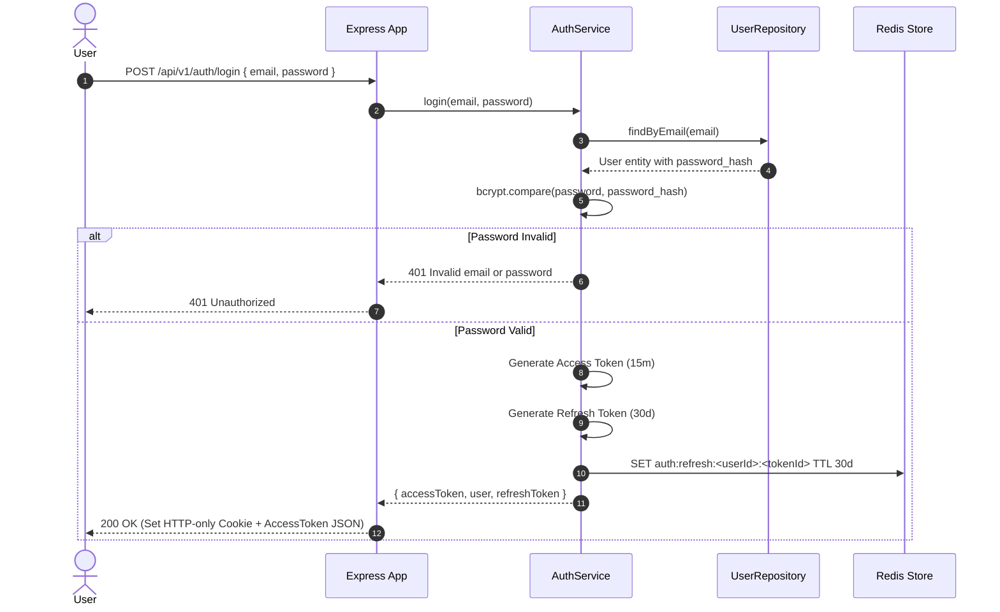
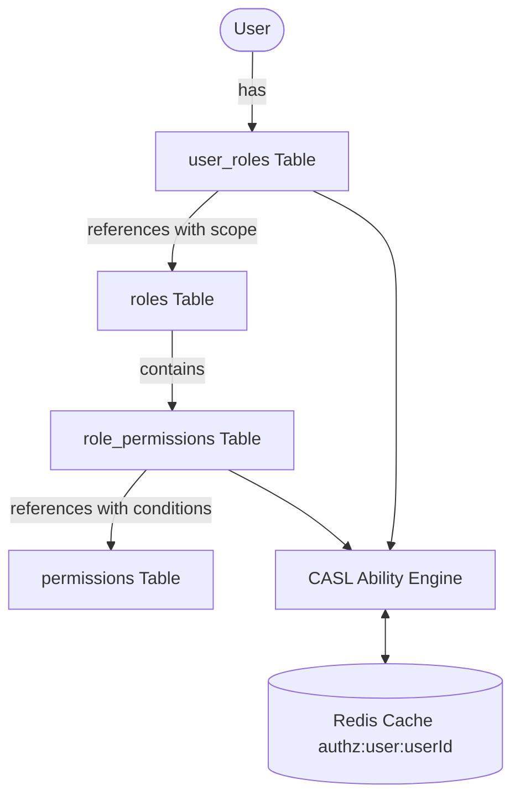

# 5 Ecommerce — Authentication & Authorization Guide

## 1. Authentication Architecture

The authentication system employs stateless JWT access tokens combined with stateful Redis-backed refresh token rotation.

### Key Security Configurations
- **`JWT_ACCESS_SECRET`**: Signs 15-minute access token (`JWT_ACCESS_EXPIRES_IN=15m`).
- **`JWT_REFRESH_SECRET`**: Signs 30-day refresh token (`JWT_REFRESH_EXPIRES_IN=30d`).
- **Cookie Security**: `refreshToken` cookie is marked `HttpOnly`, `SameSite=Strict`, `Path=/api/v1/auth`.
- **Revocation**: Logout immediately deletes the token record from Redis, invalidating any future refresh attempts.

---

## 2. Authorization Architecture (CASL RBAC)

Authorization is managed via **CASL** (`@casl/ability`). Rather than simple static role strings, users are granted dynamic permissions with support for field-level attributes, operations, and resource-scoping.

### Model Entities
1. **Roles**: Group of permissions (e.g. `admin`, `ecommerce_admin`, `user`).
2. **Permissions**: Definition of `action` on a `subject` (e.g. `manage:catalog`, `read:users`).
3. **Role Permissions**: Mapping with optional MongoDB-style JSON `conditions` (e.g. `{ "status": { "$in": ["ACTIVE", "DRAFT"] } }`).
4. **User Roles**: Assignment of a role to a user with a `scope` (`*` for global, `<ecommerceId>` for single tenant).

---

## 3. Multi-Tenant Authorization Scopes

| Scope Value | Role Applicability | Access Level |
|---|---|---|
| `"*"` or `NULL` | Global Admin (`admin`) | Unrestricted access across all tenant stores |
| `UUID` (e.g. `f18fae49-...`) | Store Admin (`ecommerce_admin`) | Scoped strictly to the specific store matching `ecommerceId` |

### Tenant Guard (`catalogTenantGuard`)
Located in [`src/modules/catalog/catalog.tenant-guard.ts`](file:///d:/Projects/Ecommerce/src/modules/catalog/catalog.tenant-guard.ts):
1. Verifies that `req.user` is present (via upstream `authenticate`).
2. Looks for `X-Ecommerce-Id` header.
3. If user has a store-scoped role (`scope !== '*'`), verifies that `X-Ecommerce-Id` matches the assigned scope.
4. Attaches resolved `ecommerceId` to `req.ecommerceId`.

---

## 4. Redis Permission Caching & Invalidation
To eliminate redundant database joins on high-throughput requests:
- Evaluated CASL rules are cached in Redis: `authz:user:<userId>` with TTL `AUTHZ_CACHE_TTL_SECONDS` (default 300s).
- **Automatic Invalidation:** Whenever roles or permissions are assigned, updated, or revoked, the authorization module automatically evicts the Redis key.
- **Manual Invalidation:** Available via `POST /api/v1/authorization/cache/invalidate`.
