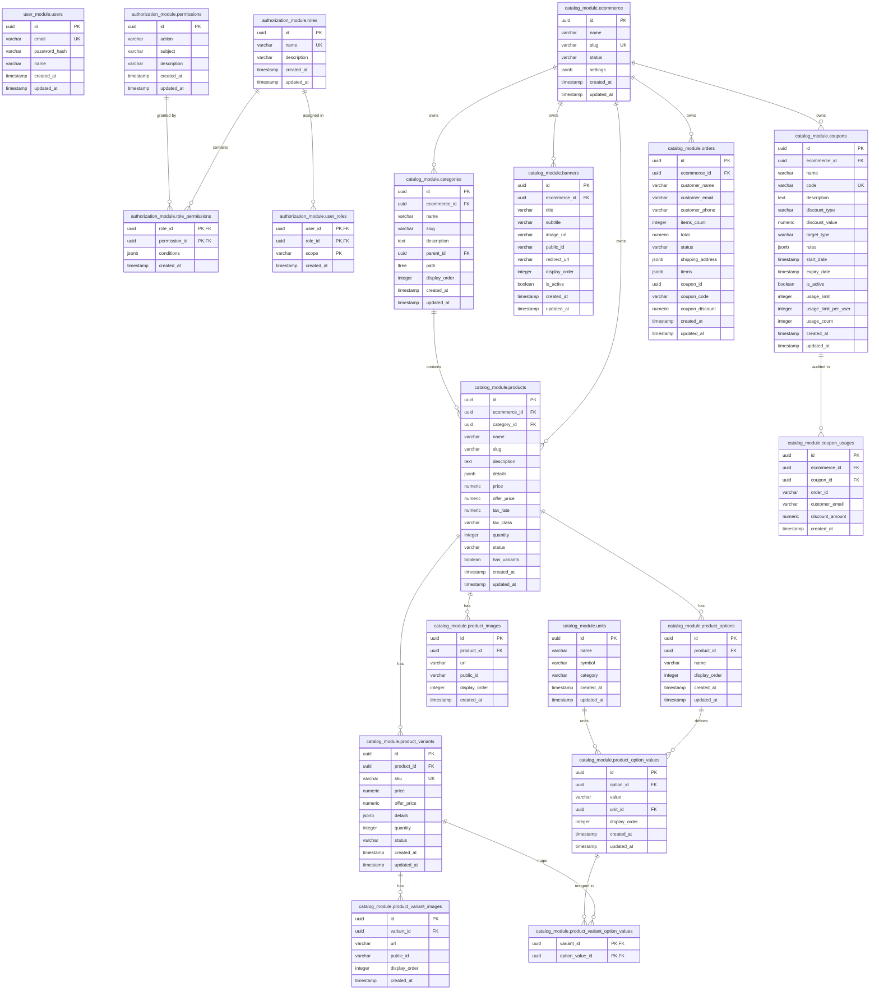

# 5 Ecommerce — Database Schema & Data Dictionary

## 1. Overview & Schema Partitioning
The database uses PostgreSQL 17 with strict schema isolation across business domains. No cross-schema foreign keys or queries are permitted by architecture rules.

Schemas initialized:
1. **`user_module`**: Persistent user authentication and account credentials.
2. **`authorization_module`**: Roles, atomic permissions, role-permission rules, and user-role scoped assignments.
3. **`catalog_module`**: Stores, hierarchical categories, products, options, units, variants, promotional banners, coupons, and orders.
4. **`notification_module`**: Reserved for persistent outbox / event persistence.
5. **`public`**: Shared Sequelize metadata (`SequelizeMeta`).

---

## 2. Complete Entity-Relationship (ER) Diagram

---

## 3. Data Dictionary by Schema

### Schema: `user_module`

#### Table: `user_module.users`
| Column | Type | Constraints | Description |
|---|---|---|---|
| `id` | `UUID` | Primary Key, Default `uuid_generate_v4()` | Unique user identifier |
| `email` | `VARCHAR(255)` | NOT NULL, UNIQUE | User email address (login credential) |
| `password_hash` | `VARCHAR(255)` | NOT NULL | Bcrypt salt and hash (10 rounds) |
| `name` | `VARCHAR(100)` | NOT NULL | User's full display name |
| `created_at` | `TIMESTAMP WITH TIME ZONE` | NOT NULL, DEFAULT `NOW()` | Record creation timestamp |
| `updated_at` | `TIMESTAMP WITH TIME ZONE` | NOT NULL, DEFAULT `NOW()` | Last update timestamp |

---

### Schema: `authorization_module`

#### Table: `authorization_module.roles`
- `id` (UUID, PK)
- `name` (VARCHAR(100), NOT NULL, UNIQUE): e.g. `admin`, `ecommerce_admin`, `user`.
- `description` (VARCHAR(255), NULL)
- `created_at`, `updated_at` (TIMESTAMPTZ)

#### Table: `authorization_module.permissions`
- `id` (UUID, PK)
- `action` (VARCHAR(100), NOT NULL): e.g. `manage`, `read`, `write`, `delete`.
- `subject` (VARCHAR(100), NOT NULL): e.g. `all`, `catalog`, `user`, `order`.
- `description` (VARCHAR(255), NULL)
- Unique Index: `(action, subject)`

#### Table: `authorization_module.role_permissions`
- `role_id` (UUID, FK -> `roles.id` ON DELETE CASCADE)
- `permission_id` (UUID, FK -> `permissions.id` ON DELETE CASCADE)
- `conditions` (JSONB, NULL): CASL JSON conditions (e.g. `{ "status": { "$in": ["ACTIVE"] } }`).
- Primary Key: `(role_id, permission_id)`

#### Table: `authorization_module.user_roles`
- `user_id` (UUID, NOT NULL): Logical reference to `user_module.users.id`.
- `role_id` (UUID, FK -> `roles.id` ON DELETE CASCADE).
- `scope` (VARCHAR(255), NOT NULL, DEFAULT `*`): Multi-tenant scope (`*` for global, `<ecommerceId>` for specific store).
- Primary Key: `(user_id, role_id, scope)`

---

### Schema: `catalog_module`

#### Table: `catalog_module.ecommerce`
- `id` (UUID, PK)
- `name` (VARCHAR(100), NOT NULL)
- `slug` (VARCHAR(100), NOT NULL, UNIQUE)
- `status` (VARCHAR(20), NOT NULL, DEFAULT `'ACTIVE'`)
- `settings` (JSONB, NOT NULL, DEFAULT `'{}'`)

#### Table: `catalog_module.categories`
- `id` (UUID, PK)
- `ecommerce_id` (UUID, FK -> `ecommerce.id` ON DELETE CASCADE)
- `name` (VARCHAR(100), NOT NULL)
- `slug` (VARCHAR(100), NOT NULL)
- `description` (TEXT, NULL)
- `parent_id` (UUID, NULL, FK -> `categories.id` ON DELETE SET NULL)
- `path` (`ltree`, NOT NULL): Materialized path (e.g. `men.hoodies`).
- `display_order` (INTEGER, NOT NULL, DEFAULT 0)
- Indexes: `CREATE INDEX idx_categories_path_gist ON categories USING GIST (path);`
- Unique Constraint: `(ecommerce_id, slug)`

#### Table: `catalog_module.units`
- `id` (UUID, PK)
- `name` (VARCHAR(50), NOT NULL, UNIQUE): e.g. `gram`, `kilogram`, `millilitre`.
- `symbol` (VARCHAR(20), NOT NULL): e.g. `g`, `kg`, `ml`.
- `category` (VARCHAR(50), NOT NULL): e.g. `weight`, `volume`, `length`, `piece`.

#### Table: `catalog_module.products`
- `id` (UUID, PK)
- `ecommerce_id` (UUID, FK -> `ecommerce.id` ON DELETE CASCADE)
- `category_id` (UUID, NULL, FK -> `categories.id` ON DELETE SET NULL)
- `name` (VARCHAR(255), NOT NULL)
- `slug` (VARCHAR(255), NOT NULL)
- `description` (TEXT, NULL)
- `details` (JSONB, NOT NULL, DEFAULT `'[]'`): Array of `{ title, content }` sections.
- `price` (NUMERIC(10, 2), NOT NULL)
- `offer_price` (NUMERIC(10, 2), NULL)
- `tax_rate` (NUMERIC(5, 2), NOT NULL, DEFAULT 0.00)
- `tax_class` (VARCHAR(50), NULL, DEFAULT `'GST 18%'`)
- `quantity` (INTEGER, NOT NULL, DEFAULT 0)
- `status` (VARCHAR(20), NOT NULL, DEFAULT `'DRAFT'`)
- `has_variants` (BOOLEAN, NOT NULL, DEFAULT FALSE)
- Unique Constraint: `(ecommerce_id, slug)`

#### Table: `catalog_module.product_options` & `product_option_values`
- `product_options`: `id`, `product_id`, `name`, `display_order`. Unique on `(product_id, name)`.
- `product_option_values`: `id`, `option_id`, `value`, `unit_id` (FK -> `units.id` ON DELETE SET NULL), `display_order`. Unique on `(option_id, value)`.

#### Table: `catalog_module.product_variants`
- `id` (UUID, PK)
- `product_id` (UUID, FK -> `products.id` ON DELETE CASCADE)
- `sku` (VARCHAR(100), NOT NULL, UNIQUE)
- `price` (NUMERIC(10, 2), NULL)
- `offer_price` (NUMERIC(10, 2), NULL)
- `details` (JSONB, NULL)
- `quantity` (INTEGER, NOT NULL, DEFAULT 0)
- `status` (VARCHAR(20), NOT NULL, DEFAULT `'ACTIVE'`)

#### Table: `catalog_module.banners`
- `id` (UUID, PK)
- `ecommerce_id` (UUID, FK -> `ecommerce.id` ON DELETE CASCADE)
- `title` (VARCHAR(255), NOT NULL)
- `subtitle` (VARCHAR(255), NULL)
- `image_url` (VARCHAR(500), NOT NULL)
- `public_id` (VARCHAR(255), NULL)
- `redirect_url` (VARCHAR(500), NULL)
- `display_order` (INTEGER, NOT NULL, DEFAULT 0)
- `is_active` (BOOLEAN, NOT NULL, DEFAULT TRUE)

#### Table: `catalog_module.coupons` & `coupon_usages`
- `coupons`: `id`, `ecommerce_id`, `name`, `code` (UPPERCASE), `discount_type` (`PERCENTAGE` | `FIXED`), `discount_value`, `target_type` (`ALL_PRODUCTS` | `PRODUCT` | `CATEGORY` | `USER_BEHAVIOR`), `rules` (JSONB), `start_date`, `expiry_date`, `is_active`, `usage_limit`, `usage_limit_per_user`, `usage_count`. Unique on `(ecommerce_id, code)`.
- `coupon_usages`: `id`, `ecommerce_id`, `coupon_id`, `order_id`, `customer_email`, `discount_amount`, `created_at`.

#### Table: `catalog_module.orders`
- `id` (VARCHAR(255), PK)
- `ecommerce_id` (UUID, NOT NULL)
- `customer_name` (VARCHAR(255), NOT NULL)
- `customer_email` (VARCHAR(255), NOT NULL)
- `customer_phone` (VARCHAR(50), NULL)
- `items_count` (INTEGER, NOT NULL, DEFAULT 1)
- `total` (NUMERIC(10, 2), NOT NULL)
- `status` (VARCHAR(50), NOT NULL, DEFAULT `'PROCESSING'`)
- `shipping_address` (JSONB, NOT NULL, DEFAULT `'{}'`)
- `items` (JSONB, NOT NULL, DEFAULT `'[]'`)
- `coupon_id` (UUID, NULL)
- `coupon_code` (VARCHAR(50), NULL)
- `coupon_discount` (NUMERIC(10, 2), NOT NULL, DEFAULT 0.00)
- `created_at`, `updated_at` (TIMESTAMPTZ)
- Index: `idx_orders_ecommerce_created ON orders (ecommerce_id, created_at DESC)`

---

## 4. Migration Execution & Order
All migrations are located in `src/infrastructure/database/migrations/` and executed sequentially via Umzug:
1. `20240101000001-create-users-table.js`
2. `20240101000002-create-authorization-tables.js`
3. `20260812160000-add-password-hash-to-users.js`
4. `20260820000001-create-catalog-tables.js`
5. `20260820000002-create-units-and-add-unit-to-options.js`
6. `20260821000001-move-unit-id-to-option-values.js`
7. `20260822000001-add-offer-price-and-images.js`
8. `20260824000001-add-banners-and-product-details.js`
9. `20260825000001-create-coupons-and-coupon-usages.js`
10. `20260831170000-add-tax-to-products.js`

To verify status: `npm run migration:status`  
To apply: `npm run migration:run`  
To dry-run: `npm run migration:dry-run`
