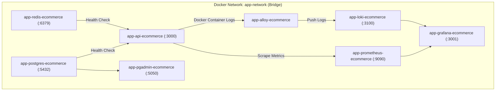

# 5 Ecommerce — Deployment & Docker Runtime Guide

## 1. Container Architecture & Multi-Stage Dockerfile

The application container uses a multi-stage Dockerfile located in [`Dockerfile`](file:///d:/Projects/Ecommerce/Dockerfile).

```mermaid
graph TD
    subgraph BuildStage["Stage 1: build (node:24-slim)"]
        Src[Source Code + Dependencies] --> Build[npm run build]
        Build --> Dist[Compiled dist/]
        Dist --> Prune[npm prune --omit=dev]
    end

    subgraph ProductionStage["Stage 2: production (node:24-slim)"]
        User[Non-Root User: appuser:appgroup (UID 1001)]
        DistCopy[Copy /app/dist]
        NodeModules[Copy production node_modules]
        Migrations[Copy database migrations]
        Health[Healthcheck: node http GET /live]
        
        User --> DistCopy
        User --> NodeModules
        User --> Migrations
        User --> Health
    end

    BuildStage -->|Artifacts Transfer| ProductionStage
```

### Security Hardening
- **Non-Root User:** Executed strictly under `appuser` (UID: 1001, GID: 1001).
- **Reduced Attack Surface:** Development dependencies, TypeScript compiler, and tests are excluded from the final image.
- **Embedded Health Check:** Uses standard Node.js HTTP call to probe `/api/v1/health/live` every 30s.

---

## 2. Docker Compose Topology & Orchestration

The full containerized stack defined in [`docker-compose.yml`](file:///d:/Projects/Ecommerce/docker-compose.yml) contains 8 coordinated services:



---

## 3. Service Inventory & Port Mapping

| Service | Container Name | Image | Host Port | Internal Port | Healthcheck |
|---|---|---|---|---|---|
| **API App** | `app-api-ecommerce` | Local Build (`Dockerfile`) | `3000` | `3000` | HTTP GET `/api/v1/health/live` |
| **PostgreSQL**| `app-postgres-ecommerce`| `postgres:17-alpine` | `5432` | `5432` | `pg_isready -U appuser -d app` |
| **Redis** | `app-redis-ecommerce` | `redis:7.4-alpine` | `6379` | `6379` | `redis-cli ping` |
| **PGAdmin** | `app-pgadmin-ecommerce` | `dpage/pgadmin4:latest` | `5050` | `80` | Via container status |
| **Prometheus**| `app-prometheus-ecommerce`| `prom/prometheus:v3.12.0` | `9090` | `9090` | HTTP status |
| **Loki** | `app-loki-ecommerce` | `grafana/loki:3.7` | `3100` | `3100` | HTTP status |
| **Alloy** | `app-alloy-ecommerce` | `grafana/alloy:v1.16.3` | N/A | N/A | Daemon service |
| **Grafana** | `app-grafana-ecommerce` | `grafana/grafana:11.5` | `3001` | `3000` | HTTP status |

---

## 4. Persistent Volumes & Data Safety

The stack defines 6 persistent named volumes:
- `postgres_data`: PostgreSQL database storage directory (`/var/lib/postgresql/data`).
- `pgadmin_data`: User preferences, saved server connections.
- `redis_data`: Append-only file (AOF) persistence storage (`/data`).
- `prometheus_data`: 15-day time-series TSDB storage (`/prometheus`).
- `loki_data`: Chunk storage for indexed log streams (`/loki`).
- `grafana_data`: Dashboard configurations and user accounts (`/var/lib/grafana`).

> [!CAUTION]
> Running `docker compose down -v` will irrevocably destroy these volumes. To halt services safely without data loss, always execute:
> ```bash
> docker compose down
> ```

---

## 5. Production Deployment SOP

1. **Pass Quality Gate:** Run all 6 steps (`type-check`, `lint`, `test`, `test:coverage`, `test:fallow`, `build`).
2. **Build Docker Image:**
   ```bash
   docker compose build
   ```
3. **Start Core Databases First:**
   ```bash
   docker compose up -d postgres redis
   ```
4. **Run Migrations:**
   ```bash
   docker compose run --rm app npm run migration:run
   ```
5. **Start Remaining Services:**
   ```bash
   docker compose up -d
   ```
6. **Verify Service Health:**
   ```bash
   docker compose ps
   curl -f http://localhost:3000/api/v1/health/live || exit 1
   curl -f http://localhost:3000/api/v1/health/ready || exit 1
   ```
